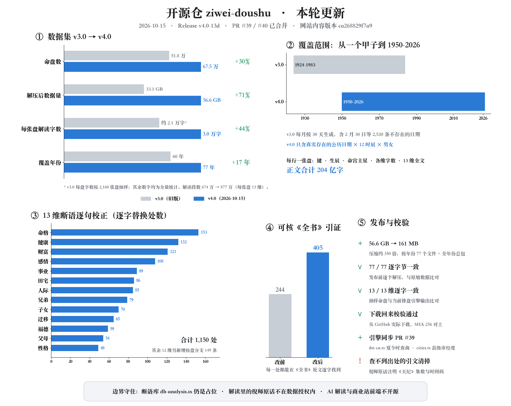

<div align="center">

# Zi Wei Dou Shu · Open-Source Charting Engine

### Algorithms are openly shared traditional wisdom; they shouldn’t be locked behind walls.

[](https://github.com/xiaochenggushiduo/ziwei-doushu/actions/workflows/ci.yml)
[](./LICENSE)
[](./DATASET-LICENSE)

[中文](./README.md) · **English**

</div>

> **About this repository**: `xiaochenggushiduo/ziwei-doushu` is the full runnable version including AI interpretation, dual-chart compatibility analysis and “My Profile”. Datasets, upstream engine and releases remain at [`Renhuai123/ziwei-doushu`](https://github.com/Renhuai123/ziwei-doushu).

**1. Philosophy:** Zi Wei Dou Shu is a treasure of traditional Chinese astrology, and Ni Haixia laid out its authentic system in *Tian Ji* (《天纪》). We hope technology can bring more people to learn it.

We open-source the charting algorithm and the knowledge base because we believe **algorithms are openly shared traditional wisdom and shouldn’t be locked behind walls**. The real value lies in the depth of interpretation, a carefully polished user experience, and what we build up by running the service day after day.

**2. About the project:** A Zi Wei Dou Shu (紫微斗数, "Purple Star Astrology") charting engine following the teaching system of **Ni Haixia's *Tian Ji* (倪海厦《天纪》)**. It includes the full charting algorithm, the Four Transformations (四化), a pattern knowledge base, public-domain classical texts, and a **518,400-chart sample dataset**, plus a **674,976-chart × 13-topic interpretation dataset (v4.0, 2026-10-15): 8.77 million readings, about 20.4 billion characters of text, 56.6 GB uncompressed** — up from 518,400 charts and 33.1 GB in v3.0.

| Dataset | Charts | Readings | Uncompressed | Years | Characters per chart |
|---|---|---|---|---|---|
| **v4.0 interpretations** (2026-10-15) | **674,976** | **8,774,688** | **56.6 GB** | **1950–2026** (real dates only) | **~30,000** |
| v3.0 samples | 518,400 | 6,739,200 | 33.1 GB | 1924–1983 | ~21,000 |
| Change | +30% | +30% | **+71%** | +17 years | +44% |

<sub>v3.0 characters per chart estimated from a 2,160-chart sample; all other figures are full counts. Both versions have 13 topics per chart.</sub>

This repo is an open snapshot of the engine behind [metisziwei.com](https://metisziwei.com/?from=gh-readme-en), synced from production periodically. This version additionally includes the AI layer (`lib/ai/`, `lib/brain/`) and the `/api/*` routes.

> **Note: on readings of family relations**
>
> Zi Wei Dou Shu has known limits when it comes to family relations (parents, siblings, children and so on). In *Tian Ji*, Master Ni Haixia said that "Dou Shu has always been somewhat weaker at reading family relations" ([lecture 2, part 1 · 00:25:27](https://www.bilibili.com/video/BV1KJsLekEfA?p=3&t=1527)). Among traditional methods, Tie Ban Shen Shu has its own strengths in checking family relations ([00:03:15](https://www.bilibili.com/video/BV1KJsLekEfA?p=3&t=195)); Master Ni still kept Zi Wei Dou Shu at the core because it can be read together with geography, surroundings and human affairs, forming a complete system that knows the heavens above, the earth below and human affairs in between ([00:25:43](https://www.bilibili.com/video/BV1KJsLekEfA?p=3&t=1543)). Readings about family relations are therefore for reference only; the Parents, Siblings and Children sections on [metisziwei.com](https://metisziwei.com/?from=gh-readme-en) carry the same note.

## Latest update (2026-10-15)



- **Interpretation dataset v4.0 released**: 674,976 charts (every real solar date 1950–2026 × 12 double-hours × male/female) × 13 topics = 8,774,688 readings; 161 MB compressed, 56.6 GB uncompressed (v3.0: 33.1 GB), 77 per-year files plus an all-years bundle. See [Release v4.0-13d](https://github.com/Renhuai123/ziwei-doushu/releases/tag/v4.0-13d) and the dataset section below.
- **The 13 topics were revised sentence by sentence** against the verbatim transcripts of Ni Haixia's *Tian Ji* and the original *Complete Book*: untraceable citations removed or replaced with verbatim quotes (with episode and timestamp), sentences about impossible transformations removed, conditions spelled out, two-sided sentences resolved per chart, and health now follows Master Ni's whole-chart method instead of mapping stars to organs by Five Element. (The judgment library itself stays closed; the results are in the v4.0 dataset.)
- **Engine sync** ([PR #39](https://github.com/Renhuai123/ziwei-doushu/pull/39)): `chinaDSTSpan(year)` in `dst-cn.ts`; longitudes for province-administered county-level cities in `cities.ts`.
- **License**: `DATASET-LICENSE` now covers v4.0; quotations from *Tian Ji* inside the readings are not covered by the dataset license.

> **2026-10-27 addendum**: engine sync. `true-solar-time.ts` accepts `utcOffsetMinutes` (the birthplace's standard UTC offset) for births outside China; results inside China are unchanged. New `clock-adjust.ts` converts a clock reading taken under daylight saving time (or an older time zone) to standard time; it never crosses midnight and is meant to run only when the user confirms. Correction: the engine detects China DST but has never subtracted it automatically; the table below said otherwise.

## What the engine handles

| Feature | Notes |
|---|---|
| True solar time | Longitude offset plus the equation of time, so births near hour boundaries are not off by one double-hour |
| China DST | 1986–1991 daylight-saving periods are detected (not subtracted automatically; convert the clock reading with `clock-adjust.ts` once the user confirms) |
| Leap months | Four configurable conventions (previous month / next month / split by day / same month) |
| Late Zi hour | 23:00–23:59 is charted on the next day, 00:00–00:59 on the same day; switchable |
| Star brightness | 7 levels (庙 旺 得 利 平 不 陷); brightness tables of different schools are switchable, not hard-coded |
| Four Transformations | Natal, decade (大限) and annual (流年) transformations, plus flying-star self-transformations |
| Twelve spirits | Natal layer by year branch, annual layer by the annual branch |
| Patterns | 1,100+ lines of pattern rules (紫府同宫, 日月并明, 七杀朝斗, …) |

Engine code lives in `lib/ziwei/` (entry point: `generateChart()` in `algorithm.ts`). Inputs are a **Gregorian** date and an **hour branch index 0–11** (子 = 0 … 亥 = 11), not a clock hour.

## Quick start

```bash
git clone https://github.com/xiaochenggushiduo/ziwei-doushu.git
cd ziwei-doushu
npm ci
npm run dev          # charting demo at http://localhost:3000/chart

npm run typecheck    # TypeScript check
npm test             # charting regression tests
```

**No API key is needed for charting.** The AI layer is included: AI interpretation (`/api/interpret`), compatibility analysis (`/api/heming`) and profile extraction (`/api/brain/extract`) work once you set an OpenAI-compatible key in `.env.local`. Without a key they return a clear configuration error.

## AI features

| Feature | Notes |
|---|---|
| Streaming interpretation | `/api/interpret` streams over SSE; the insight panel supports multi-turn follow-ups and builds prompts for the natal / decade / annual context. |
| Dual-chart compatibility | `/api/heming` receives two charts and streams an analysis around spouse-palace cross-reading, life-palace compatibility and the triangle-four-position structure. |
| My Profile (brain) | Extracts structured “topic / conclusion / chart evidence / confidence” from an answer, stores it in browser `localStorage`, and injects relevant entries (≤10) by chart fingerprint on later readings. Supports edit, confirm, refute, delete, import/export, and pre-filling birth data from a saved profile. |
| Anti-fabrication validation | The server checks that every palace, star, transformation and pattern cited as evidence exists in the current chart; `answer` excerpts must be substrings of the original reading; uploaded profiles are re-fingerprinted server-side and rejected wholesale on mismatch. |
| Provider-agnostic | Any OpenAI-compatible API: DeepSeek (default), MiMo, OpenAI or a self-hosted gateway, switched via `AI_PROVIDER` / `*_API_KEY` without code changes. |
| Server safeguards | Chart/message validation, client `system` messages dropped, in-memory rate limiting (20 interpretations/min, 10 compatibility analyses/min per IP), profile field allow-list. |
| Time navigation | Natal / decade / annual views, with a direct year input, range clamping and a “back to this year” action. |
| Privacy | Profiles live only in the local browser; only the entries under the current chart fingerprint are sent to the model provider when you start a reading. |

See [`.env.example`](./.env.example) and [`docs/ai-setup.md`](./docs/ai-setup.md). AI output is traditional-culture commentary, not medical, investment or legal advice.

## What is not included

The commercial interpretation database (`lib/ziwei/db-analysis.ts` is a placeholder), user accounts, payments, commercial-server security and deployment configuration.

## Interpretation dataset v4.0 (674,976 charts × 13 topics, 2026-10-15)

Download from [Releases → v4.0-13d](https://github.com/Renhuai123/ziwei-doushu/releases/tag/v4.0-13d): 77 per-year files `year-YYYY.jsonl.zst` (161 MB compressed, 56.6 GB uncompressed (v3.0: 33.1 GB)), plus `SHA256SUMS.txt` and `MANIFEST.json`.

- Every solar date from 1950 to 2026 (only dates that actually exist) × 12 double-hours × male/female; one chart per line (JSON Lines).
- Fields: `k` key, `y`/`m`/`d` solar date, `h` double-hour index 0–11 (not clock hours), `g` gender, `ms` first major star of the Life Palace (`null` if empty), `t` character counts, `c` the 13 topic readings in Markdown.
- Generated deterministically by the charting engine and the 2026-10-15 judgment library (content version `ca268829f7a9`), no AI involved. The 13 topics were revised sentence by sentence against the verbatim transcripts of Ni Haixia's *Tian Ji* and the original *Complete Book of Zi Wei Dou Shu*.
- Natal-chart view only: age-based rewording, the appended Master Ni rule sections and AI readings shown on the website are not included. Charts use the double-hour index directly, without true-solar-time correction.
- Decompress with `zstd -d --long=27 year-1990.jsonl.zst` (`--long=27` is required).
- Quotations from Ni Haixia's *Tian Ji* inside the readings are **not covered by the dataset license**: they are short citations with episode and timestamp, and copyright in the original lectures remains with the rights holder; bulk reuse of those quotations falls under the [CC BY-NC-SA 4.0](./docs/tianji-ziwei/LICENSE.md) terms of chapter 5. The *Complete Book* is in the public domain.
- License: same as v3.0 — [CC BY 4.0](./DATASET-LICENSE), commercial use OK with attribution (except the quotations above).
- A single all-years bundle `ziwei-interp-v4-all.tar` is also provided.

## Sample dataset (518,400 charts)

Download from [Releases](https://github.com/Renhuai123/ziwei-doushu/releases/tag/v3.0-samples) (3 parts, 5.5 GB in total). Each sample is generated from `birthInfo`:

- `year` / `month` / `day`: **Gregorian** date, 1924–1983 (one full 60-year cycle), days 1–30 of every month
- `hour`: **hour branch index 0–11** (子 = 0 … 亥 = 11), *not* a clock hour; the `hHH` part of each file name is the same index
- `gender`: `male` / `female`; `longitude` is fixed at 120 (no local true-solar-time correction)

**Known issue:** about 2,520 samples (0.49%) carry dates that do not exist: Feb 30, and Feb 29 in non-leap years. The engine silently rolled them over to Mar 1–2, so their content duplicates the Mar 1–2 samples. Filter out `month = 2 && day = 30`, and `month = 2 && day = 29` in non-leap years. From 2026-10-03 the engine rejects non-existent dates.

## Ni Haixia's original words (*Tian Ji*, Zi Wei part)

[`docs/tianji-ziwei/`](./docs/tianji-ziwei/) holds **1,848 quotes** from the Zi Wei lectures of *Tian Ji* (14 lectures plus 2 supplements), each linked to the second it was said in the video. Taken from the sister repo [nihai-tianji-corpus](https://github.com/Renhuai123/nihai-tianji-corpus).

## Citations and acknowledgements

### Method and corpus

- **Ni Haixia, *Tian Ji* · Zi Wei Dou Shu**: the charting conventions, Four Transformations, patterns and interpretation framework follow Master Ni's *Tian Ji* lectures. The verbatim quotes are collected in [`docs/tianji-ziwei/`](./docs/tianji-ziwei/) (1,848 entries, each with a Bilibili timestamp) under CC BY-NC-SA 4.0 — **non-commercial use only**.
- **Classical texts**: *Zi Wei Dou Shu Quan Shu* (Chen Xiyi edition), *Zi Wei Dou Shu Quan Ji* and *Gu Sui Fu* are in the public domain; see [`lib/classics/`](./lib/classics/).
- **Interpretation datasets**: v4.0 and v3.0 are CC BY 4.0. Please attribute `https://github.com/Renhuai123/ziwei-doushu` and the author “王多鱼AI”; see [`DATASET-LICENSE`](./DATASET-LICENSE).

### Open-source software

| Project | Use | License |
|---|---|---|
| [iztro](https://github.com/SylarLong/iztro) | Zi Wei Dou Shu charting reference | MIT |
| [lunar-javascript](https://github.com/6tail/lunar-javascript) | Lunar calendar, solar terms and sexagenary conversion | MIT |
| [Next.js](https://nextjs.org/) | React full-stack framework | MIT |
| [React](https://react.dev/) | UI runtime | MIT |
| [Tailwind CSS](https://tailwindcss.com/) | Styling | MIT |
| [Framer Motion](https://www.framer.com/motion/) | Animation | MIT |
| [DeepSeek](https://www.deepseek.com/) | Default AI provider (OpenAI-compatible) | Per its terms of service |

### Citing this project

If this project helps your research, product or article, please cite:

```bibtex
@misc{ziweiDoushu2026,
  title        = {Zi Wei Dou Shu: Open-Source Charting Engine and AI Interpretation},
  author       = {{王多鱼AI}},
  year         = {2026},
  howpublished = {\url{https://github.com/xiaochenggushiduo/ziwei-doushu}},
  note         = {Code MIT; datasets CC BY 4.0; Ni Haixia quotes CC BY-NC-SA 4.0}
}
```

You can also use [`CITATION.cff`](./CITATION.cff) at the repository root (GitHub shows a “Cite this repository” button).

## License

| Part | License |
|---|---|
| Code (`lib/`, `app/`, `components/`) | [MIT](./LICENSE) |
| Sample dataset (Releases) | [CC BY 4.0](./DATASET-LICENSE): commercial use OK with attribution |
| Classical texts | Public domain |
| Ni Haixia quotes (`docs/tianji-ziwei/`) | [CC BY-NC-SA 4.0](./docs/tianji-ziwei/LICENSE.md): **non-commercial only** |

Contributions are welcome. Please read [CONTRIBUTING.md](./CONTRIBUTING.md); questions go to [Discussions](https://github.com/Renhuai123/ziwei-doushu/discussions).
